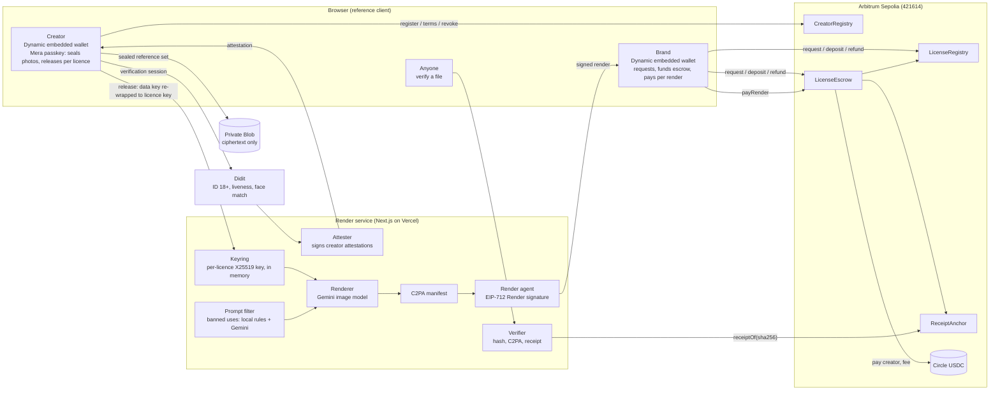

# Likeness: license your face to AI, on your terms

**Live demo:** [likeness.website](https://likeness.website) · **Pitch video:** <PITCH_URL> ·
**Demo video:** <DEMO_URL> · **Code:** [github.com/rohitshukla11/likeness.website](https://github.com/rohitshukla11/likeness.website)

Likeness is a likeness-licensing protocol on Arbitrum, with a reference app on top. Real, verified adults
license their face to brands and AI tools, get paid in USDC for every image made with it, and can pull
it back at any time.

## The problem

Generative AI can put anyone's face into an ad in seconds. The people in those images are rarely asked,
almost never paid, and have no way to stop it. Brands that *want* to use a real person's likeness have
no clean way to get consent, pay per use and prove it later: today the options are a one-off model
release signed for a photoshoot, or nothing at all.

## The solution

Likeness turns consent into a licence that software can check. A creator proves they are a real, live
adult, seals encrypted reference photos of their face and publishes terms. A brand requests a licence,
the creator approves it, and every image rendered under it pays the creator and records an on-chain
receipt in the same transaction. Each file carries a C2PA content credential, anyone can check it, and
one click revokes the licence so the next render is refused.

## How it works

**Verify → License → Earn → Prove or revoke**

1. **Verify.** The creator signs in with email, and a Dynamic embedded wallet is created for them. Didit
   checks an ID document for 18+, a liveness selfie and a selfie-to-ID face match. Three guided photos
   are matched to that selfie, encrypted in the browser under a key from the creator's passkey (Mera),
   and only the ciphertext is uploaded. The platform attests the creator on chain.
2. **License.** The creator sets uses, regions, a price per render and limits. A brand with a brand
   profile requests a licence; the creator approves it with an EIP-712 signature (or it is issued at once
   inside their auto-approve terms). The brand deposits USDC into escrow.
3. **Earn.** The creator releases their photos to that licence only. Each render checks the licence, the
   cap, the escrow and the banned-use filter, decrypts the photos in memory, renders with Gemini, signs a
   C2PA manifest and calls `LicenseEscrow.payRender`: the creator is paid, the 10% fee is taken and the
   receipt is anchored, in one transaction.
4. **Prove or revoke.** Anyone can drop a file on `/verify` and see Licensed, Expired, Revoked or
   Unknown, with the creator, the licensee and the receipt. The creator can revoke one licence or all of
   them: the next render is refused, earlier files verify as "licensed when made, since revoked", and the
   brand refunds the unused escrow.

## Architecture



**Contracts** ([`contracts/src`](contracts/src)):

| Contract | What it holds | Who writes |
|---|---|---|
| [`CreatorRegistry`](contracts/src/CreatorRegistry.sol) | Platform-signed attestation (Didit: ID 18+, liveness, face match), terms, payout, revocation epoch | Creator (terms, payout, revoke-all); the attester signs but cannot submit; the owner rotates the attester and can suspend for abuse |
| [`LicenseRegistry`](contracts/src/LicenseRegistry.sol) | Non-transferable, expiring licences (ERC-721 locked per [ERC-5192](https://eips.ethereum.org/EIPS/eip-5192)) | Brand requests with the creator's EIP-712 approval, or inside auto-approve terms; creator revokes; only the escrow counts renders |
| [`LicenseEscrow`](contracts/src/LicenseEscrow.sol) | USDC per licence; pays the creator per render, refunds the rest | Brand deposits; a render needs the brand's wallet **and** a render agent's signature |
| [`ReceiptAnchor`](contracts/src/ReceiptAnchor.sol) | One receipt per rendered file, looked up by its sha256 | Only the escrow, only inside a paid render |

**Integrations:** [Dynamic](docs/integrations/dynamic.md) (email sign-in, embedded wallets),
[Mera](docs/integrations/mera.md) (passkey PRF encryption keys), Didit (identity), Google Gemini (renders
and the prompt filter), C2PA (content credentials). History is read from the contracts' logs over RPC; an
Envio HyperIndex for Arbitrum Sepolia ([`indexer/`](indexer)) is included and optional.

## Why blockchain, why USDC, why Arbitrum

- **A licence everyone can check.** The licence, its terms, every render and every revocation are public
  records that no party can quietly edit, Likeness included. A verifier needs only the file.
- **Per-render payments need low fees and fast confirmation.** Every image is one transaction (usage,
  payment and receipt together), confirmed before the file is released to the brand. On Arbitrum Sepolia
  the gas price was 0.02 gwei at deployment, and the whole deployment (four contracts and three wiring
  transactions, 8.2M gas) cost 0.000165 ETH. Measured confirmation times are in the table below.
- **USDC.** Creators are paid in dollars, not a volatile token. Circle issues USDC natively on Arbitrum,
  and the escrow uses Circle's own USDC contract on Arbitrum Sepolia.
- **Ethereum security.** Arbitrum is a rollup that settles to Ethereum, so licences and receipts inherit
  Ethereum's security at a fraction of mainnet's cost.
- **Users never touch crypto.** Creators and brands sign in with email, the wallet is created for them,
  and gas is covered: every new wallet gets a one-time top-up from the platform.

## Deployed contracts on Arbitrum Sepolia

Deployed 2026-10-12 (UTC) from `0x68343Aa0598b7FCAA102769D172e59cdDfae10f2`, starting at L2 block
318,467,180, and verified on Arbiscan. Machine-readable:
[`deployments/arbitrum-sepolia.json`](deployments/arbitrum-sepolia.json).

| Contract | Address | Deploy tx |
|---|---|---|
| CreatorRegistry | [`0xE096452bE57EE285c3D7d29752d1Ac6854b538D5`](https://sepolia.arbiscan.io/address/0xE096452bE57EE285c3D7d29752d1Ac6854b538D5#code) | [`0x44057eaf…`](https://sepolia.arbiscan.io/tx/0x44057eafbaa8225b778ad8e98e0c548b70aaffc48dff445982eae5c0943d610f) |
| LicenseRegistry | [`0xE344b053a8935ACB887863Bb6201B6Fc9Cbc2320`](https://sepolia.arbiscan.io/address/0xE344b053a8935ACB887863Bb6201B6Fc9Cbc2320#code) | [`0x4504b9e3…`](https://sepolia.arbiscan.io/tx/0x4504b9e39d3381ab7624b7b3215901824bc6370d3146499bea9cdeb9bd971513) |
| ReceiptAnchor | [`0x448B136468289216036a4C13995EA02C39F6B871`](https://sepolia.arbiscan.io/address/0x448B136468289216036a4C13995EA02C39F6B871#code) | [`0xc6af292c…`](https://sepolia.arbiscan.io/tx/0xc6af292ca8b8af9ceebe2ddc30ca106af506f2e370f27d17c6b1e04b34849c74) |
| LicenseEscrow | [`0x50a730C0e9998e1F40a3211f00239ea60Be08163`](https://sepolia.arbiscan.io/address/0x50a730C0e9998e1F40a3211f00239ea60Be08163#code) | [`0xf43c271b…`](https://sepolia.arbiscan.io/tx/0xf43c271bfcf5cf896ab14868e3790a969b854fb3ecab891b7b90d4aa1e06f1ba) |
| USDC (Circle) | [`0x75faf114eafb1BDbe2F0316DF893fd58CE46AA4d`](https://sepolia.arbiscan.io/address/0x75faf114eafb1BDbe2F0316DF893fd58CE46AA4d) | [Circle docs](https://developers.circle.com/stablecoins/usdc-contract-addresses) |

Wiring: [`LicenseRegistry.setEscrow`](https://sepolia.arbiscan.io/tx/0x33c10280b85feb7ca4a038112f1921ff8a250fa05789b32ec1f340caa08053e6),
[`ReceiptAnchor.setEscrow`](https://sepolia.arbiscan.io/tx/0xf6f98df95202a3e95a9897c44b1b52a2b1b322d2970eb6ac1a162bea4f69860a),
[`LicenseEscrow.setRenderAgent`](https://sepolia.arbiscan.io/tx/0xbca89ed9f1c2581857d0099b9bf0cff02883c62db086731c51a27d01374fcf7f).
Roles: attester `0x8d53e13407890e18022bfAa413193ba4C6DCc1a5`; render agent
`0x331f0F6fb5c3c09d84Ae2C1D533b4F739dA6E87d`; owner and treasury, the deployer; fee 10%.

**Confirmation times** (send to receipt, in the browser, over the public RPC):

| Step | Transaction | Time |
|---|---|---|
| Register a creator | `CreatorRegistry.register` | measured on the live deployment |
| Request a licence | `LicenseRegistry.request` | measured on the live deployment |
| Deposit | `LicenseEscrow.deposit` | measured on the live deployment |
| Pay a render | `LicenseEscrow.payRender` | measured on the live deployment |
| Revoke | `LicenseRegistry.revoke` | measured on the live deployment |
| Refund | `LicenseEscrow.refund` | measured on the live deployment |

## Business model and go-to-market

- **Customers:** AI ad and avatar tools that need real, consented faces, and the brands that use them.
- **Revenue:** a 10% fee on every paid render, taken by the escrow contract in the same transaction that
  pays the creator.
- **Go-to-market:** start with AI UGC ad tools and the creators who already make UGC ads. Tools get a
  catalogue of verified faces with clear terms; creators get paid every time their face is used.
- **Demand validation:** [__ creators on the waitlist, __ tools in conversation].

## Running it locally

Needs Node 22 or later and Foundry 1.8.3 (for anvil and the contracts).

```sh
cd web
cp .env.example .env.local     # local defaults; add credentials as they arrive
pnpm install
pnpm c2pa:testcert             # once: a TEST C2PA signing chain in ../.secrets/c2pa
pnpm dev                       # http://localhost:3000
```

Each credential switches on one feature, and `/status` shows what is configured: Dynamic
(`NEXT_PUBLIC_DYNAMIC_ENV_ID`), Didit (`DIDIT_API_KEY`, `VERIFICATION_LEVEL`, workflow IDs; the `free`
level also needs `pnpm face:models`), Gemini (`GEMINI_API_KEY`, a billed key) and the gas top-up
(`DRIP_KEY_FILE`). Without Gemini, development builds render a clearly marked TEST RENDER; production
builds refuse to render instead.

**The whole protocol in one command**, on a local anvil fork of Arbitrum Sepolia with the deployed
contracts and Circle's real USDC contract (a throwaway, unverified test creator exists only there):

```sh
pnpm demo --fork
```

It registers the test creator, funds a test brand, issues and funds a licence, releases the key, runs two
renders and verifies one, revokes, shows the next render refused, and refunds, printing every
transaction.

**Indexer (optional).** `cd indexer && pnpm install && pnpm local` runs the Envio HyperIndex against
Arbitrum Sepolia with an embedded Postgres; set `ENVIO_PG_URL` in `web/.env.local` to use it. Without it,
the app reads history from cached RPC log scans. Current state always comes from the contracts.

### Tests

```sh
cd contracts && forge test     # unit, fuzz, invariant; with RPC_URL set, also the Arbitrum Sepolia fork suite
cd web && pnpm test            # crypto, render pipeline, profiles, and the licence lifecycle on an anvil fork
cd indexer && pnpm test        # Envio handlers on the in-memory test indexer
```

- **Contracts:** every revert path; fuzz tests that banned uses are never stored or licensed and that
  each render conserves funds; an invariant suite for USDC conservation, render caps and refunds.
- **Web:** the cross-device passkey test and envelope encryption; the banned-use filter, the C2PA round
  trip and tamper detection; and, on an anvil fork of Arbitrum Sepolia with the deployed contracts and no
  mocks, the whole licence lifecycle (approval, deposit, key release, delegated and wallet `payRender`,
  verify, revoke, refund, revoke-all), re-verification at a higher level, and public profiles, samples and
  brand onboarding.

### Deploying

Production runs on Vercel at `https://likeness.website`. The full guide, with the domain records, Dynamic
settings and every environment variable, is in [`docs/deploy-vercel.md`](docs/deploy-vercel.md). In short:
a new project from this repository with root `web`, a private Blob store,
`sh scripts/vercel-env.sh https://likeness.website` from `web/`, and a redeploy without the build cache.

## Privacy and safety

- **Only ciphertext is stored.** Reference photos are encrypted in the creator's browser (AES-256-GCM)
  under a key derived from their passkey through Mera. The server stores ciphertext and hashes, and the
  chain holds only a hash of the encrypted manifest and of the Didit session ID. Keys and plaintext live
  in memory for one operation and are zeroed afterwards.
- **What Didit sees, and for how long.** Didit sees the ID document and the liveness selfie, and at the
  `full` level matches the three reference photos. Likeness asks Didit not to keep a face-search
  embedding, calls photo matches with `save_api_request=false`, and deletes the session with
  `privacy_erasure` as soon as the attestation is signed. Didit's own retention is a console setting
  (unlimited by default), and it uses data for model training unless the organisation opts out; the
  operator must set both. Likeness keeps the outcome and the session ID, never the date of birth,
  document images or selfie.
- **What Google sees, and for how long.** The Gemini image model receives the decrypted reference photos
  for each render. On a billed key Google doesn't use them to improve its products, but logs them for 55
  days for abuse monitoring ([Gemini API terms](https://ai.google.dev/gemini-api/terms)). A free-tier key
  must never be used with creators' photos.
- **Banned uses are enforced in the contract.** Political, adult, anything involving minors,
  impersonation and deception are a constant bitmask in [`Categories.sol`](contracts/src/Categories.sol):
  no terms, signed deal or role can license them. The render service applies the same list to every
  prompt before generation.
- **Adults only.** `CreatorRegistry` registers only attested adults (18+ computed from the ID's date of
  birth), and the app is presented as adults-only.
- **Every output is marked.** Each render carries a C2PA manifest declaring it AI-generated, Google's
  SynthID watermark, and an on-chain receipt keyed by its exact bytes.

## Known limitations and roadmap

Limitations today:

- **Didit level.** `VERIFICATION_LEVEL=free` uses passive liveness and matches the reference photos on our
  server; it resists deepfakes and camera injection less well than `full` (active liveness and Didit's
  1:1 match), which needs Didit credit. The level is recorded on chain and shown everywhere.
- **Test C2PA certificate.** Manifests are signed with a locally generated certificate that is not on the
  C2PA trust list; the verifier says so.
- **Dynamic delegated access is sandbox-only** without a Dynamic Enterprise plan, so brands confirm each
  `payRender` in their own wallet by default.
- **Gas is a top-up, not sponsorship.** New wallets get a one-time ETH top-up from a platform key, with
  per-IP and hourly caps. Dynamic's gas sponsorship doesn't list Arbitrum Sepolia.
- **No TEE.** Render keys and decrypted photos are held in ordinary process memory on one instance, and a
  photo release may need repeating when Vercel routes a request to another instance.
- **Receipts bind exact bytes.** A re-encoded or cropped copy verifies as Unknown. Revocation is not
  recall: files delivered earlier still exist and verify as "licensed when made, since revoked".
- **One central attester key** attests creators; it can be rotated.

Roadmap:

- **Sponsored gas via EIP-7702 + paymaster,** so new wallets need no top-up at all.
- **Casting calls:** a brand posts a brief, and matching creators choose whether to reveal themselves.
- **"Casting calls only" mode:** a creator is never browsable, and appears only to brands they answer.
- **Brand KYB** through Didit (a hook is in the brand profile; nothing claims it today).
- **A trusted C2PA certificate** and a hosted Envio indexer.

## Disclosures

- A separate Monad version of Likeness is live at likeness.site (repo rohitshukla11/Likeness) and entered
  in Monad Metropolis.
- The design tokens (colours, type scale, radii) are reused from my earlier project, Whistle.
- Built with AI-assisted development using Claude Code, which I directed and reviewed.

## Contributor notes

- **No real brand or product names** in demos, fixtures, tests, docs, screenshots or placeholder text. Use
  fictional ones, such as "Brew & Co." or "Northline Apparel", and `.example` domains. Infrastructure the
  app runs on (Arbitrum, Circle, Dynamic, Didit, Gemini and so on) and free email domains in the
  domain-check logic are the only real names in the code.

## License

[MIT](LICENSE)
